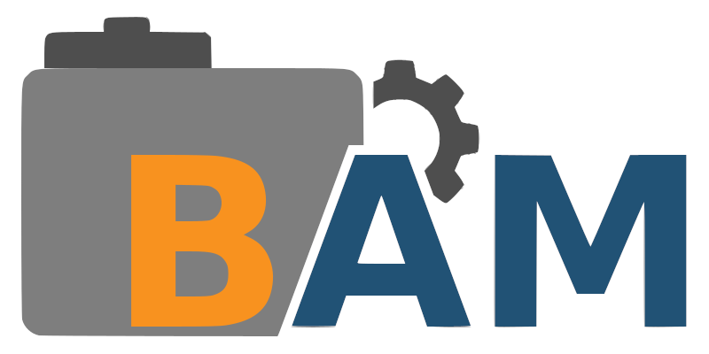

<p align="center">
  
</p>

# BAM: Better Actuator Models

> **This repository is a fork of [Rhoban/bam](https://github.com/Rhoban/bam).**
> The "Changes in this fork" section below lists what was changed to train the
> Kid_RL humanoid (legs: MX-106(2.0) and XH540, hip yaw: MX-64(2.0), arms and
> neck: MX-28(2.0)) in mjlab / MuJoCo Warp. It is based on upstream commit
> `4e060cf`; later upstream commits are not merged yet. The original README
> follows unchanged after this section.

## Changes in this fork

### 1. New servo models (Protocol 2.0 Dynamixel)

| Key (`motor_name`) | Servo | Class (`bam/dynamixel/actuator.py`) |
|---|---|---|
| `mx28` | MX-28(2.0) | `MX28Actuator` |
| `mx64v2` | MX-64(2.0) | `MX64V2Actuator` |
| `mx106v2` | MX-106(2.0) | `MX106V2Actuator` |
| `xh540` | XH540-W270 | `XHActuator` |

- **Why:** upstream `mx64` and `mx106` target the Protocol 1.0 firmware and use
  an oscilloscope-measured `error_gain=0.158`. The servos on the robot run the
  2.0 firmware, whose control table and P-gain scaling differ (same table as
  XH540: Goal Position 116, Present PWM 124, PWM Limit 36, 4096 counts/rev).
- **error_gain:** computed as `(4096 / 2π) / (KP_DIVISOR · PWM_LIMIT)`.
  - The datasheet gives `KP_DIVISOR = 128`, but measurement gave about 147 for
    MX-106(2.0) and 141.32 for MX-64(2.0) (see `configure_kp_divisor.py`
    below). XL330 showed the same kind of mismatch.
  - MX-28(2.0) and XH540 still use the datasheet value 128.
- **Parameters:** m1–m6 parameters fitted with `bam.fit` from pendulum
  test-bench recordings of the real servos are in
  `bam/params/{mx28,mx64v2,mx106v2,xh540}/`.
- **Registration:** the four classes are added to the `actuators` dict in
  `bam/actuators.py`.
  - `BamActuatorCfg(motor_name=...)` reads `params/<motor_name>/<model>.json`
    directly, so mjlab can use the new keys with no code change.

### 2. Identification tools

- **`DynamixelXH540` in `bam/dynamixel/dynamixel.py`:** a Protocol 2.0 driver
  built directly on dynamixel_sdk, also used as-is for MX-28/64/106(2.0).
  - Reads are retried and validated.
  - The hardware-error indicator (ALERT bit) is kept separate from real
    communication errors, so a persistent input-voltage error no longer
    blocks communication.
  - The rad↔raw position conversion is fixed to match this hardware's
    Position Control Mode (raw 0..4095, unsigned), using the formula from
    ROBOTIS `dynamixel_hardware_interface`.
- **`bam/dynamixel/configure_kp_divisor.py` (new):** measures the firmware Kp
  divisor without an oscilloscope. It commands a small triangle-wave goal,
  reads back the servo's Present PWM, and fits
  `KP_DIVISOR = kp · error / (duty · PWM_LIMIT)` by least squares.
- **`bam/dynamixel/record.py`:**
  - The servos above are recorded through `DynamixelXH540`.
  - `--logdir` is created before recording starts. Before, a missing folder
    was only found at the final save.
  - Log key `"arm-mass"` → `"arm_mass"`. The old name did not match the key
    `testbench.py` reads, so the arm mass was silently taken as 0.
- **`bam/dynamixel/all_record.py`:** kp lists for the new servos.
  - The mx64v2/mx106v2 kp values are converted so they give the same duty
    cycle as the existing v1 logs (kp 4, 8, 16, 32).
  - The wait after the `sin_time_square` trajectory is 3 → 10 s (servo
    cool-down).
- **`bam/fit.py`:**
  - `--eval` used to ignore `--output` and load `params.json`; fixed.
  - `--eval` also scored on logs that were used for training; with
    `--validation_kp` it now scores only the held-out logs.
  - Added `--eval_all_kp` to report a separate score for each kp.
- **`bam/model.py` search bounds:** widened because fits of the new servos
  hit the bounds.
  - `load_friction_motor_quad` upper bound 0.01 → 0.3
  - Stribeck `alpha` range [1, 10] → [0.1, 60]
- **`pyproject.toml`:** pinned `optuna<4.4.0`. From 4.4.0 on, CmaEsSampler's
  `restart_strategy` (bipop/ipop) is silently ignored.

### 3. mjlab actuator (`bam/mjlab.py`)

- **Torque clamp bug fix (commit `41aa0c2`):**
  - `set_to_motor()` keeps the `<position>` actuator's `ctrlrange` (a joint
    angle in rad). A motor actuator's ctrl is a torque (Nm), so BAM's torque
    was clamped to the joint-angle range, e.g. hip roll to ±1.19 Nm and knee
    to 1.59 Nm instead of their 6–8 Nm limits.
  - `ctrlrange` is now reset to the torque limit.
  - Upstream later fixed the same problem separately.
- **Added `BamActuatorCfg.preserve_joint_friction`:** for joints listed here,
  BAM does not zero the XML `damping`/`frictionloss` and does not apply
  `stiff_frictionloss`.
  - Meant for joints that match the regex but whose friction BAM does not
    compute, such as a linkage's follower joint.
- **Added a `BamActuatorCfg.max_current` field:** it is not passed on to the
  BAM actuator yet, so it currently has no effect. The current limit itself
  lives in `VoltageControlledActuator(max_current=...)` in `bam/actuator.py`.
- **Docs:** the `motor_name` docstring lists the servos bundled now.

### 4. Other files

- `bam/scratch_add_slot_followers.py`: a scratch script used to add Kid_RL's
  crank-slider mechanisms to the MJCF. Its paths are hard-coded to a local
  machine.

Accurate models of servo actuators are essential for the simulation of robotic systems. It is particularly important while performing Reinforcement Learning (RL) on real robots, as the precision of the model impacts directly the transferability of the learned policy.

The friction model generally implemented in widely used simulators like MuJoCo or IsaacGym is the Coulomb-Viscous, which is too simplistic to accurately represent complex friction phenomena like Stribeck, load-dependence or quadratic effects (read [this article](https://arxiv.org/pdf/2410.08650v1) for more details).

**BAM** aims at making servo-actuator simulation more faithful by:

- proposing an identification pipeline to fit friction models from recorded trajectories,
- providing a set of extended friction models that capture complex friction phenomena,
- sharing a library of identified models for common servos:
  - Dynamixel MX-64
  - Dynamixel MX-106
  - Dynamixel XL-320
  - Dynamixel XL330-288-T
  - eRob80:50
  - eRob80:100
  - Feetech STS3215
- providing a simple API to use these models in MuJoCo CPU and MuJoCo Warp.

## 📖 Documentation

Please refer to the [documentation](https://bam.readthedocs.io/en/latest/) for more details on how to use BAM and the provided friction models.

## 📚 Citation

If you use BAM or the friction models provided in this repository for your scientific work, please cite the following publication:

```bibtex
@inproceedings{duclusaud2025extended,
  title={Extended Friction Models for the Physics Simulation of Servo Actuators},
  author={Duclusaud, Marc and Passault, Gr{\'e}goire and Padois, Vincent and Ly, Olivier},
  booktitle={2025 IEEE International Conference on Robotics and Automation (ICRA)},
  pages={12091--12097},
  year={2025},
  organization={IEEE}
}
```

If you also wish to cite the software directly, you may use:

```bibtex
@software{BAM,
  title = {{BAM: Better Actuator Models}},
  author = {Duclusaud, Marc and Passault, Grégoire},
  license = {Apache-2.0},
  url = {https://github.com/Rhoban/bam},
  version = {0.0.1},
  year = {2024}
}
```
